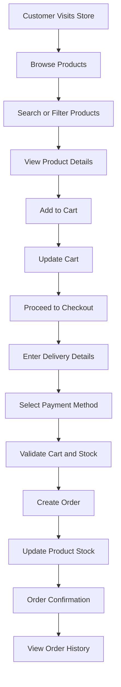

# 🥒 Pickle Store – Homemade Pickles & Snacks

A full-stack **e-commerce web application** built with **Python, Django, and MySQL** for selling homemade pickles and snacks.

- 🛒 Customers can browse products and manage their shopping cart
- 🔍 Search products and filter by category
- 📦 Manage product inventory and stock availability
- 🧾 Place orders and view order history
- 🔐 Django authentication with secure password handling
- ⚙️ Admin panel for managing products and orders

This project demonstrates practical Django development, database management, authentication, shopping cart functionality, and order processing.

---

## 📚 Table of Contents

1. [What This Project Does](#-what-this-project-does)
2. [Application Flow](#-application-flow)
3. [Features](#-features)
4. [Tech Stack](#-tech-stack)
5. [Project Structure](#-project-structure)
6. [Database Overview](#-database-overview)
7. [Shopping Cart](#-shopping-cart)
8. [Checkout and Order Processing](#-checkout-and-order-processing)
9. [Security](#-security)
10. [How to Run Locally](#-how-to-run-locally)
11. [How to Use the Application](#-how-to-use-the-application)
12. [Testing](#-testing)
13. [What I Learned](#-what-i-learned)
14. [Interview Talking Points](#-interview-talking-points)

---

## 🎯 What This Project Does

Pickle Store is a Django-based online store where customers can browse homemade pickles and snacks, add products to their shopping cart, and place orders.

The application provides a complete shopping workflow, from viewing products to checkout and tracking previous orders.

### 👤 Customer

- Browse available products
- View product descriptions, prices, images, and stock availability
- Search for products
- Filter products by category
- Add products to the shopping cart
- Update product quantities
- Remove products from the cart
- Enter delivery information during checkout
- Select an available payment method
- Place orders
- View order confirmation
- View previous orders

### 🛠️ Admin

- Add new products
- Edit product details
- Upload or manage product images
- Manage product prices and categories
- Update stock quantities
- View customer orders
- Manage order statuses
- Manage store data through Django Admin

---

## 🔄 Application Flow



### 🔁 Order Processing Flow

1. Customer adds products to the cart.
2. Cart quantities are updated as required.
3. Customer proceeds to checkout.
4. Delivery details and payment method are submitted.
5. The application validates product availability.
6. Product stock is rechecked during checkout.
7. Order creation and stock updates are performed transactionally.
8. The order is saved in the database.
9. The customer can view the order confirmation and order history.

---

## ✨ Features

### 🛍️ Product Management

- Product catalogue with images
- Product descriptions and pricing
- Product categories
- Product search
- Category filtering
- Stock availability
- Display available stock
- Out-of-stock handling

### 🛒 Shopping Cart

- Session-based shopping cart
- Add products to cart
- Update product quantities
- Remove cart items
- Display cart item count
- Calculate item totals
- Calculate cart total
- Validate quantities against available stock

### 📦 Order Management

- Checkout with customer information
- Delivery details
- Multiple products in a single order
- Payment method selection
- Order confirmation
- Order history
- Order status management

### 📊 Inventory Management

- Product stock tracking
- Stock availability validation
- Prevent ordering unavailable quantities
- Revalidate stock during checkout
- Automatically deduct stock after successful order creation
- Protect stock updates using database transactions

### 🔐 Authentication

- User registration
- User login
- User logout
- Django authentication system
- Password hashing
- Protected user-related functionality

### ⚙️ Admin Management

- Django Admin integration
- Product management
- Stock management
- Order management
- Order status updates

---

## 🛠️ Tech Stack

| Layer | Technology | Purpose |
|---|---|---|
| Backend | Python | Application logic |
| Web Framework | Django 5.2 | Server-side development |
| Database | MySQL | Persistent data storage |
| Frontend | HTML | Page structure |
| Styling | CSS | UI styling |
| Client-side | JavaScript | Interactive functionality |
| Authentication | Django Authentication | User login and registration |
| Database Access | Django ORM | Database queries and operations |
| Version Control | Git | Source code version control |
| Repository | GitHub | Project hosting |

---

## 📁 Project Structure

```text
pickle_store/
│
├── manage.py
├── requirements.txt
├── README.md
├── .env.example
├── .gitignore
│
├── pickle_store/
│   ├── settings.py
│   ├── urls.py
│   ├── wsgi.py
│   └── asgi.py
│
├── store/
│   ├── models.py
│   ├── views.py
│   ├── urls.py
│   ├── admin.py
│   ├── tests.py
│   └── migrations/
│
├── templates/
│
├── static/
│
└── media/
    └── products/
```

<sub>Note: Folder names may differ slightly depending on your Django project configuration.</sub>

### 📄 Important Files

| File | Description |
|---|---|
| `manage.py` | Django management commands |
| `settings.py` | Project configuration, database, apps, middleware, security |
| `urls.py` | URL routing |
| `models.py` | Database models |
| `views.py` | Application logic and request handling |
| `admin.py` | Django Admin configuration |
| `tests.py` | Automated tests |
| `requirements.txt` | Project dependencies |
| `.env` | Environment variables and configuration |
| `.gitignore` | Files excluded from Git |

---

## 🗄️ Database Overview

The application uses **MySQL** as its database.

Django ORM is used to interact with database records through Python models rather than writing SQL queries for every operation.

### 📦 Product

The Product model stores information about the products available in the store.

| Field | Description |
|---|---|
| Name | Product name |
| Description | Product information |
| Price | Product selling price |
| Image | Product image |
| Category | Product category |
| Stock | Available quantity |

### 🧾 Order

Orders store customer purchase information, including order details, customer information, delivery information, payment method, and order status.

### 🛍️ Order Items

Order items represent individual products included in an order, including the purchased quantity and price.

The application supports multiple products within a single order.

---

## 🛒 Shopping Cart

The shopping cart uses Django sessions to store cart information.

A session-based cart allows customers to manage their cart without requiring cart information to be stored as a permanent database record for every cart interaction.

### Cart Operations

- Add a product
- Update quantity
- Remove a product
- View cart items
- Calculate subtotal
- Calculate total amount
- Check product stock

### Stock Validation

The application checks product availability to prevent customers from adding or purchasing quantities greater than the available stock.

Stock is revalidated during checkout to avoid relying only on the quantity checked earlier while adding items to the cart.

---

## 📦 Checkout and Order Processing

Checkout converts the shopping cart into a customer order.

### Checkout Process

1. Retrieve cart items from the session.
2. Validate customer and delivery information.
3. Verify product availability.
4. Recheck stock quantities.
5. Lock product records where required during checkout.
6. Create the order and order items.
7. Deduct purchased quantities from inventory.
8. Commit the transaction.
9. Display order confirmation.

### Database Transactions

Django database transactions are used during order processing to protect the consistency of order creation and inventory updates.

If an operation fails during the transaction, database changes can be rolled back to prevent partial order processing.

---

## 🔐 Security

The application uses Django's built-in security and authentication features.

- Django authentication system
- Secure password hashing
- Password validation
- CSRF protection
- Environment-based configuration
- Sensitive settings excluded from Git
- Session-based cart handling
- Protected user functionality
- Stock validation during checkout
- Database transactions for order processing

Sensitive configuration such as secret keys and database credentials is stored in environment variables rather than committed to the GitHub repository.

---

## 🚀 How to Run Locally

### 1. Clone the Repository

```bash
git clone https://github.com/bhargav2018/pickle-store.git
```

### 2. Navigate to the Project

```bash
cd pickle-store
```

### 3. Create a Virtual Environment

```bash
python -m venv venv
```

### 4. Activate the Virtual Environment

**Windows:**

```bash
venv\Scripts\activate
```

### 5. Install Dependencies

```bash
pip install -r requirements.txt
```

### 6. Configure Environment Variables

Create a `.env` file in the project root directory.

Configure the required settings using `.env.example` as a reference.

Example configuration:

```env
SECRET_KEY=your-secret-key
DEBUG=True

DB_NAME=pickle_db
DB_USER=root
DB_PASSWORD=your-database-password
DB_HOST=127.0.0.1
DB_PORT=3306
```

Use your own local database credentials.

### 7. Create the MySQL Database

Create the database in MySQL before running migrations.

```sql
CREATE DATABASE pickle_db;
```

### 8. Apply Migrations

```bash
python manage.py migrate
```

### 9. Create an Admin Account

```bash
python manage.py createsuperuser
```

### 10. Run the Development Server

```bash
python manage.py runserver
```

### 11. Open the Application

Store:

[http://127.0.0.1:8000/](http://127.0.0.1:8000/)

Django Admin:

[http://127.0.0.1:8000/admin/](http://127.0.0.1:8000/admin/)

---

## 🎮 How to Use the Application

### 👤 Customer Workflow

1. Open the store.
2. Register a new account.
3. Login using your credentials.
4. Browse the product catalogue.
5. Search for products or filter by category.
6. Add products to the cart.
7. Change quantities or remove products.
8. Proceed to checkout.
9. Enter customer and delivery information.
10. Select an available payment method.
11. Place the order.
12. View the order confirmation.
13. View your order history.

### ⚙️ Admin Workflow

1. Open Django Admin.
2. Login using the admin account.
3. Add or update products.
4. Set product prices and stock quantities.
5. Manage product categories and details.
6. Review customer orders.
7. Update order statuses.

---

## 🧪 Testing

The project includes automated tests for application functionality.

Run the test suite:

```bash
python manage.py test
```

The tests help verify application behavior and catch errors during development.

The project test suite has been executed successfully.

---

## 🎓 What I Learned

- Building a full-stack web application using Django
- Organizing a Django project and application
- Working with Django models and ORM
- Connecting Django with MySQL
- Implementing user authentication
- Creating dynamic pages using Django templates
- Handling forms and user input
- Implementing session-based shopping cart functionality
- Managing product inventory
- Validating product stock
- Processing orders
- Using database transactions
- Working with database migrations
- Writing automated tests
- Managing source code using Git and GitHub
- Configuring environment variables
- Understanding basic application security

---

## 🧠 Interview Talking Points

**1. Why did you use Django?**

Django provides built-in features such as authentication, ORM, URL routing, middleware, forms, and admin management, which help build web applications efficiently.

**2. Why did you use MySQL?**

MySQL is a relational database used to store structured application data such as products, users, orders, and order items.

**3. How does your shopping cart work?**

The shopping cart uses Django sessions to store cart items and quantities between requests.

**4. How do you prevent customers from ordering more than available stock?**

The application validates product availability when managing the cart and rechecks the stock during checkout before creating the order.

**5. How do you prevent stock inconsistencies during checkout?**

Checkout uses database transactions and product row locking where required to protect stock updates and order creation.

**6. What happens when order processing fails?**

Transactional database operations can roll back changes so the database does not retain partially completed order updates.

**7. How do you manage products?**

Products can be created, updated, and managed through Django Admin.

**8. How do you secure user passwords?**

Django's authentication system uses password hashing rather than storing plain-text passwords.

**9. Why use environment variables?**

Environment variables allow sensitive configuration such as secret keys and database credentials to be separated from the source code.

**10. How did you test the application?**

The project includes automated Django tests that can be executed using `python manage.py test`.

---

## 📜 License

This project is intended for educational and portfolio purposes.

---

## 🙌 Author

**Bhargav**

Django Full-Stack Developer | Python | Django | MySQL

GitHub: [bhargav2018](https://github.com/bhargav2018)

---

### 🥒 Pickle Store

*Built with Django, Python, and MySQL.*